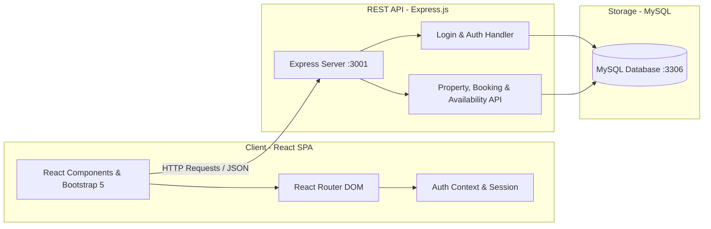

# LiveLuxe - Luxury Lodging & Property Rental Platform


**LiveLuxe** is a full-stack vacation rental and apartment lodging platform inspired by modern hospitality systems. It connects property hosts and travelers through an intuitive, responsive interface featuring dynamic search, real-time availability tracking, booking management, and role-based access control.

---

## Table of Contents

- [Overview](#overview)
- [Key Features](#key-features)
  - [Guest Experience](#guest-experience)
  - [Host Experience](#host-experience)
  - [Platform & Security](#platform--security)
- [Architecture & Tech Stack](#architecture--tech-stack)
- [Database Schema](#database-schema)
- [Getting Started](#getting-started)
  - [Prerequisites](#prerequisites)
  - [1. Clone Repository](#1-clone-the-repository)
  - [2. Database Setup & Seeding](#2-database-configuration--seeding)
  - [3. Backend Setup](#3-run-the-backend-server)
  - [4. Frontend Setup](#4-run-the-frontend-client)
- [Demo Credentials](#demo-credentials)
- [API Endpoints Overview](#api-endpoints-overview)
- [Project Structure](#project-structure)
- [Authors & Acknowledgments](#authors--acknowledgments)
- [License](#license)

---

## Overview

LiveLuxe simplifies the process of exploring, renting, and hosting luxury properties. Designed with modularity and user experience in mind, the platform provides dedicated workflows for both guests seeking accommodations and hosts managing their real estate portfolio.

---

## Key Features

### Guest Experience
- **Smart Search & Filtering**: Discover properties by location (city/state), date range (check-in/check-out), and guest count. Refine searches with advanced amenity filters (Wi-Fi, swimming pool, air conditioning, kitchen, free parking) and property categories (Villa, Apartment, Studio, etc.).
- **Rich Property Details**: High-resolution image galleries, pricing breakdown per night, detailed amenities overview, house rules, and verified guest reviews with star ratings.
- **Interactive Booking Flow**: Live availability verification calendar, automated total cost calculation, and simulated checkout with major payment methods (Visa, MasterCard, American Express).
- **Personal Booking Dashboard**: View past and active reservations with real-time status indicators (*Pending*, *Confirmed*, *Cancelled*).
- **Profile Management**: View and verify registered contact information and account details.

### Host Experience
- **Property Listing Management**: Register new properties complete with location, category, maximum guest capacity, bedroom count, amenities checklist, descriptive notes, and multi-image uploads.
- **Dynamic Availability & Pricing**: Open specific calendar date windows, assign custom seasonal nightly rates, and control property availability.
- **Reservation Control**: Review incoming guest booking requests, monitor reservations, and manage confirmation or cancellation statuses.
- **Host Dashboard**: Dedicated overview of all owned properties and their performance.

### Platform & Security
- **Role-Based Access Control (RBAC)**: Distinct views and navigation adapted dynamically for guests and hosts.
- **Secure Authentication**: User registration and login with SHA-256 hashed password storage and session persistence using React Context API.
- **Protected Routes**: Client-side route guards preventing unauthorized access to booking and management consoles.

---

## Architecture & Tech Stack



### Technology Highlights
- **Frontend**:
  - [React.js](https://reactjs.org/) (Functional Components, Hooks, Context API)
  - [React Router DOM](https://reactrouter.com/) (Declarative Client-side Routing & Route Guards)
  - [Bootstrap 5](https://getbootstrap.com/) & Custom CSS (Responsive Design & Clean Card Layouts)
- **Backend**:
  - [Node.js](https://nodejs.org/) & [Express.js](https://expressjs.com/) (RESTful Web Service)
  - [Body-Parser](https://www.npmjs.com/package/body-parser) & [CORS](https://www.npmjs.com/package/cors)
- **Database**:
  - [MySQL](https://www.mysql.com/) (Relational schema with referential integrity)
  - Node.js MySQL driver with automatic WSL host resolution

---

## Database Schema

The database model is structured around 9 relational tables:

| Table | Description |
| :--- | :--- |
| **`users`** | User profiles, credentials (SHA-256), contact info, and host flag (`IsHost`). |
| **`locations`** | Geographic registry containing city and region/state mappings. |
| **`categories`** | Housing categories (e.g., *Apartment*, *Villa*, *Studio*, *Bilocale*). |
| **`properties`** | Accommodation details, amenities (WiFi, Pool, AC, Kitchen, Parking), address, and ownership. |
| **`availabilities`**| Calendar intervals with custom nightly rates (`PricePerNight`) per property. |
| **`bookings`** | Reservation records (dates, total price, status, guest reference). |
| **`payments`** | Transaction logs linked to bookings with timestamps and amounts. |
| **`reviews`** | Guest feedback, numerical star ratings (1–5), and review dates. |
| **`images`** | Photo assets and descriptive metadata mapped to property listings. |

---

## Getting Started

### Prerequisites
Make sure you have the following installed on your machine:
- **Node.js** (v16.x or higher) & **npm** (v8.x or higher)
- **MySQL Server** (running locally or via XAMPP / Docker / WSL)

---

### 1. Clone the Repository
```bash
git clone https://github.com/LorenzoLosi72/IT-Project-LiveLuxe.git
cd IT-Project-LiveLuxe
```

---

### 2. Database Configuration & Seeding

1. Start your **MySQL service**:
   ```bash
   # Linux / WSL
   sudo service mysql start

   # Or launch MySQL from your XAMPP Control Panel
   ```

2. Create the database named `liveluxe`:
   ```sql
   CREATE DATABASE liveluxe;
   ```

3. Configure your connection settings if needed in `config/connection-database.js`:
   ```javascript
   let connection = mysql.createConnection({
       host: process.env.DB_HOST || 'localhost',
       user: 'root',
       password: '', // Enter your MySQL root password if applicable
       database: 'liveluxe'
   });
   ```

4. Run the automated database population script to create tables and load mock sample data:
   ```bash
   node config/population-database.js
   ```

---

### 3. Run the Backend Server

Install dependencies and start the API server:
```bash
# From project root
npm install

# Start the Express server
node config/server.js
```
The server will start listening at: `http://localhost:3001`

---

### 4. Run the Frontend Client

In a separate terminal tab:
```bash
# Launch the React development client
npm start
```
The web application will open in your browser at: `http://localhost:3000`

---

## Demo Credentials

You can test the application using the pre-seeded accounts created by the database population script:

| Role | Username | Password | Notes |
| :--- | :--- | :--- | :--- |
| **Host** | `lucarossi` | `password123` | Can manage properties, set availabilities, and review bookings |
| **Host** | `marcoverdi` | `password789` | Host account with active property listings |
| **Guest / Client** | `giuliabianchi` | `password456` | Standard traveler account with reservations history |
| **Guest / Client** | `saraconti` | `password1011`| Standard traveler account |

---

## API Endpoints Overview

| Method | Endpoint | Description |
| :--- | :--- | :--- |
| `POST` | `/api/login` | Authenticate user credentials and return role/session info |
| `POST` | `/api/register` | Register a new client or host account |
| `POST` | `/api/user-data` | Retrieve detailed profile data for a specific user |
| `GET` | `/api/houses` | Fetch all properties with their primary images |
| `GET` | `/api/house/:id` | Fetch detailed information, reviews, and images for a property |
| `POST` | `/api/search` | Search properties by location, date window, guest count, and filters |
| `GET` | `/api/house/:id/availability` | Fetch available calendar ranges and nightly rates for a listing |
| `POST` | `/api/bookings` | Create a new property booking |
| `POST` | `/api/payments` | Record payment details associated with a reservation |
| `POST` | `/api/host-properties` | Fetch all properties managed by a specific host |
| `GET` | `/api/host-bookings/:userID` | Retrieve incoming reservations for a host's properties |
| `POST` | `/api/update-booking-status`| Update reservation status (*Confirmed* / *Cancelled*) |
| `POST` | `/api/register-property` | Create and list a new accommodation |
| `POST` | `/api/add-availability` | Add availability intervals and pricing for a property |
| `GET` | `/api/locations` | List available cities and regions |
| `GET` | `/api/categories` | List available property categories |

---

## Project Structure

```text
IT-Project-LiveLuxe/
├── config/                         # Backend configuration and database management
│   ├── function-population/        # Modular database seeding scripts (users, properties, etc.)
│   ├── images/                     # Seed image assets
│   ├── connection-database.js      # MySQL connection setup and dynamic WSL/host binding
│   ├── login-handler.js            # Authentication logic and credential validation
│   ├── population-database.js      # Main database reset and population pipeline
│   └── server.js                   # Express application entrypoint and REST API routes
├── public/                         # Public static web assets
│   ├── images/properties/          # Property listing photos
│   └── index.html                  # HTML5 application template
├── src/                            # React application source code
│   ├── components/                 # Reusable UI components
│   │   ├── Booking-Page.jsx        # Reservation checkout & payment interface
│   │   ├── Card-House.jsx          # Property card catalog display
│   │   ├── Header.jsx              # Dynamic role-aware navigation bar
│   │   ├── Host-Booking.jsx        # Host reservation management dashboard
│   │   ├── Host-properties.jsx     # Host accommodation portfolio
│   │   ├── House-Description.jsx   # Detailed property view & booking calendar
│   │   ├── Login.jsx               # User authentication portal
│   │   ├── Manage-property.jsx     # Host property calendar and availability manager
│   │   ├── Registration.jsx        # User signup form (Guest & Host)
│   │   ├── Rent-Home.jsx           # Host property creation form
│   │   ├── Searchbar.jsx           # Advanced search and filtering bar
│   │   ├── User-Account.jsx        # User profile view
│   │   └── User-Booking.jsx        # Guest booking history
│   ├── css/                        # Component-specific and global styling
│   ├── images/logos/               # Platform and payment branding assets
│   ├── Auth-Context.js             # React Context for global auth state & role management
│   ├── App.jsx                     # Route definitions and application layout
│   └── index.jsx                   # React root entrypoint
├── IT-Project-LiveLuxe-Presentation.pdf # Project presentation slide deck
├── LICENSE                         # MIT License
├── package.json                    # Project dependencies and metadata
└── README.md                       # Project documentation
```

---

## Authors & Acknowledgments

Developed as an academic software engineering / IT project:
- **Lorenzo Losi** ([@LorenzoLosi72](https://github.com/LorenzoLosi72))
- **Lorenzo Apolone** ([@ApoloneL](https://github.com/ApoloneL))

*Department of Engineering and Architecture — University of Parma (Università degli Studi di Parma)*

---

## License

This project is licensed under the **MIT License** — see the [LICENSE](LICENSE) file for details.
